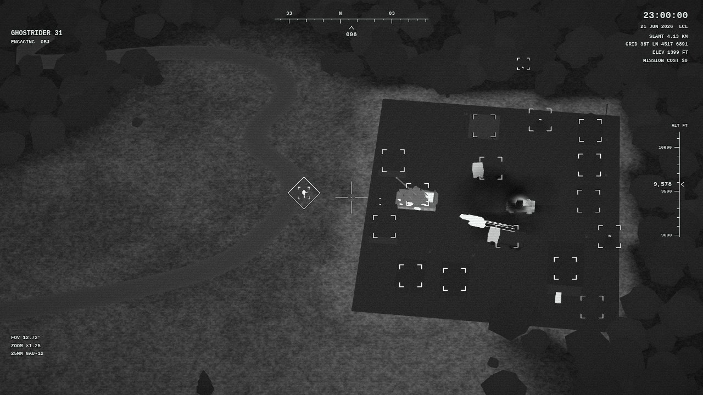
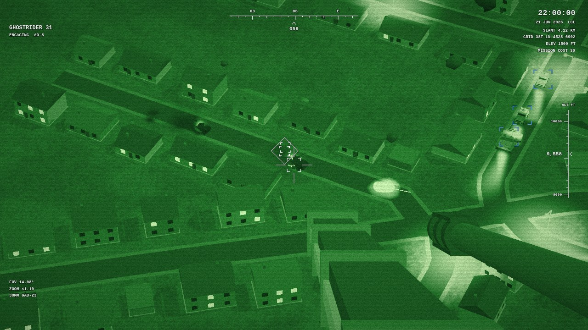
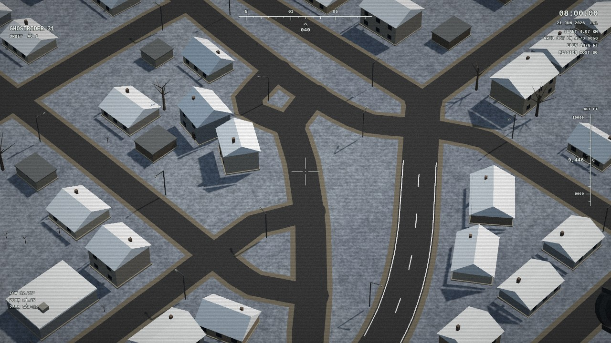

# Danger Close — web wallpaper for Wallpaper Engine

The view through an AC-130 gunship's sensor. The aircraft flies a slow left-hand orbit over a generated countryside —
hills, lakes, a river, towns, roads and a railway, fields and forests — and the picture is what its camera sees: TV,
white-hot or black-hot thermal, or night vision, under a sensor HUD with your own callsign. In silence the allies patrol
out of their outposts. When music plays the enemy comes in columns and builds a base, and the gunship fires on the beat.
Day and night follow your PC clock, the land follows the seasons.

- **Live demo** (runs in the browser): https://wladbelsky.github.io/Danger-Close/

## Install

1. Copy the `Danger Close` folder into
   `...\Steam\steamapps\common\wallpaper_engine\projects\myprojects\`,
   or in Wallpaper Engine choose **Open Wallpaper → Open from File** and pick `project.json`.
2. The fight needs music: audio recording must be on in Wallpaper Engine's settings (it is by default).
3. The vision-mode buttons (top left) and the weapon selector (bottom) need mouse input enabled in Wallpaper Engine.

## Performance

The world is built once at start under the splash screen (usually 2–4 s); after that the simulation takes a fraction of a
millisecond a frame and the picture a few hundred draw calls. To go lighter: lower the **FPS limit** in Wallpaper
Engine (30 is plenty), set **Quality** to Medium or Low, turn **Shadows** off. Wallpaper Engine pauses it under
fullscreen apps by default.

To measure it on your machine: in Wallpaper Engine set **Settings → General → CEF devtools port** (e.g. 8080), open
`http://localhost:8080` in Chrome, pick the wallpaper and run `perfReport(60)` in its console — after a minute it logs the
frame rate and frame times, the CPU time split into the simulation and the drawing, draw calls and triangles, units, soldiers,
lamps and memory. Run it once in silence and once in a fight with music.

## The sensor

- **Four vision modes**: TV (a low-light daylight camera), thermal white-hot and black-hot, night vision. Thermal shows
  real heat: engines and gun barrels hot, wrecks cooling in stages, the ground warmer than the air at night, water the
  other way round, smoke cold. Click a mode on the HUD; the **Vision mode at start** property sets the default — *Auto*
  out of the box: TV by day, thermal at night; or *Auto* with night vision at night.
- **The HUD**: mode, callsign, compass, altitude ladder, the PC clock, a reticle per weapon, corner brackets on what it
  tracks (allies blue, enemies white), the weapon selector with cosmetic ammunition and reloads. At the top right, the
  mission cost: the money the gunship has fired off, each weapon at its own price, counting up to each new sum, and back
  to zero after a minute of silence (**Mission cost on the HUD** turns it off). It keeps clear of the
  taskbar (**HUD space kept free at the bottom**) and scales with **HUD scale**.
- **The camera**: a left orbit over one area, a transit to another every few minutes in silence; in a fight it slews
  onto the enemy, each weapon with its own zoom — lazily in a quiet part, fast and sharp when the music drives hard.
- **The big guns in frame**: the barrels of the 105 mm and the railgun (while enabled) at the bottom right, fixed to the
  aircraft — they move in the frame as the sensor turns and zooms, recoil on every shot, flash, smoke and heat up. The
  other guns sit on the same side of the fuselage, out of the frame: their rounds come in from its right edge.

## The fight

- **Music arms it**: after 5 s of sound the enemy arrives — always out of sight — in columns along the roads, squads and
  helicopters, and builds a base on a cleared site. The camera stays where it is and they come to it; it moves to the base or
  another fight only in a quiet part of the music. They keep coming: a wrecked base is soon rebuilt, and when nothing is left
  in view the next ones are called in at once.
- **The allies** are always out: garrisons in walled outposts, patrols, helicopters; in a fight the garrisons sortie to the
  enemy base, and their reinforcements come where the sensor looks. Both sides shoot at each other.
- **The gunship fires on the beat**, only at what is under the reticle and only at what its weapon may hit:

| Weapon | Infantry | Car | APC | Tank | Helicopter | Beat |
|---|---|---|---|---|---|---|
| 25 mm Gatling | + | + | + | | | high |
| 30 mm cannon | + | + | + | | | mid |
| 105 mm howitzer | + | + | + | + | | low |
| 40 mm Bofors | + | + | + | | | mid |
| Hellfire | | + | + | + | | strong |
| APKWS rockets | + | + | + | | | strong |
| GBU-39 | + | + | + | + | | strong |
| CBU-97 cluster bomb | + | + | + | + | | strong, skeets on the sixteenths |
| AIM-9X | | | | | + | strong |
| Laser (red, lights up what it hits) | + | + | + | + | + | held on the beat |
| Railgun | + | + | + | + | + | strong, through a column |

  The light guns cut down infantry and cars but only wear down armour: an APC takes a long hammering from the 25 mm (the
  rounds glance off in sparks), a tank shrugs it off. A GBU-39 brings a base building down at one bomb, and what stands
  next to it. Its reticle is drawn on the ground: the blast's ring and the line the bomb falls down, ticked at heights over
  the point (the further off the sensor looks, the longer); the APKWS's shows the ground its salvo covers. The CBU-97 opens over a column: its submunitions come down
  on chutes and fire their skeets one after another on the sixteenths, each at a vehicle the others have not done for. The guns open up as a target comes onto the reticle, their rounds
  walking onto it, and now and then a shot lands wide.
  The first three are on by default; each is a property. Automatic switching picks one for the targets and the music,
  and while the one in hand reloads it fires another;
  a click on one holds it for 30 s, or until nothing it may hit is left round where the aircraft is.
- **Everything plays to the music**: the soldiers and the technicals fire on the hats, the APCs and helicopters on the snare,
  the tanks on the kick, and a strong beat is a volley; denser music, faster fire (at the same damage); the gunship's bursts
  grow with the beat. The faster the tempo, the faster the guns: the 25 mm, 30 mm and Bofors fire between the beats too, in
  time with the kick (eighths, sixteenths for the 25 mm), the 105 mm reloads sooner, the ground units fire more often. A quiet part calms the fight, the drop after it sets everything off at once. The AA fires on the beat,
  the flares go on the strong ones. The helicopters of both sides fly fast on their rounds or slow round a target they
  have picked, nose on it, and loose a salvo of rockets on a beat at what is dead ahead.
- **APCs carry infantry**: halted near the enemy (or at their own base) they let a squad out by the rear door, one by one,
  and the column waits for them; the soldiers run out in file and spread round. A knocked-out APC lets one to three bail out.
- **Blasts hurt everything round them**: a 105 mm shell, a bomb or a rocket hits every enemy within its radius, not only
  the kinds the weapon is aimed at (a Hellfire on a tank takes the soldiers beside it too). Never their own side.
- **Hits show**: a knocked-out vehicle cooks off on the next strong beats (a tank may throw its turret), a column under
  fire weaves across the road. A vehicle hit on the move rolls on for a few seconds, slowing, before it stands burning.
- **Allies in the fight**: their fireteams and columns come where the sensor looks, run into the picture and fight beside
  the enemy in it; the camera rather picks a target with an ally right by it, so you see what the enemy is firing at.
- **Infantry under fire scatters**: soldiers near a hit run off from it, the squad spreads out, then they fight on. They keep
  their distance from the other side's armour, and some carry rocket launchers: a rocket with a smoke trail at a vehicle now
  and then.
- **Turrets keep to their target**: a tank or an APC sticks with what it is firing at and turns to the nearest one it is already
  pointing at, instead of swinging back and forth.
- **Smooth driving**: vehicles steer round the corners of a road instead of turning on the spot, each slows for its own bend,
  and a swerve eases in and out. They keep out of each other: they brake for what is ahead, pull aside for one coming the other
  way and drive round a wreck or a halted column.
- **The armour comes to the fight**: enemy columns drive on to where the camera looks (to the nearest road, even when the fight is
  out in the fields, across them) instead of stopping to fight the allies somewhere out of sight. Out of the frame nobody fights
  and the vehicles drive as they like; near it they keep out of each other without jittering.
- **Off the road**: enemy armour leaves the road to assault the allies' infantry in the fields, a column halted for a fight
  takes positions beside the road, and one the gunship hits breaks off it like a herringbone, each vehicle forward and off to one side, every other one the other way (round the wrecks of its own), holds, and goes again if it is hit there, then goes on alone.
- **Helicopters over the fight**: the enemy's circle over the frame and go for what is in it. A helicopter flies fast, firing its
  gun only at what is in front of it and its rockets only dead ahead (a rocket run comes of it on the way in), or slow round its
  target, sliding sideways with its nose on it, gun and rockets as it bears; never shooting behind itself.
- **Detailed helicopters**: cockpits with flat panes set in their frames, tapering blades on a full rotor head, sensors, guns,
  rockets and missiles on their pylons, wheels, hot exhausts on the thermal sensor.
- **The reticle is where the guns fire**: always in the frame's centre; at the map's edge the sensor stops where the frame can
  still be centred on it.
- **No round wasted**: a target a missile in flight will kill is left to it; the other weapons and the sensor go on to the next.
- **The Hellfire rides the laser**: the sensor lases the vehicle under the reticle, the seeker locks on the spot, SHOOT, and in
  flight the missile goes for the spot while the sensor holds it there, LASE and the time of flight on the HUD.
- **The AIM-9X locks on**: the corners of a diamond close in on the helicopter's box under the reticle, a dot once locked,
  a boxed SHOOT over the weapon selector, and the launch half a second on.
- **No lull**: as one group dies the next is already coming in from the edge of the frame, more and sooner the faster the
  music; very slow music goes group by group with a short break between them.
- **The music stops**: 5 s later fire ceases, the enemy pulls back out of the frame and vanishes; the base is removed
  once it is out of view. Infantry vanish in a puff of dust (every hit on a soldier kicks some up), vehicles lie as wrecks and
  sink. No civilians, no blood.

## The world

- About 2 × 2 km, made from a **seed** (0 = a new map every start): gentle hills, lakes and a river, a town and villages,
  a station on the railway, farms, roads with bridges, fields and forests.
- **Seasons** by the PC date (or fixed): spring green, autumn colours, snow and bare trees in winter.
- **Weather**: rain, snow, fog, clouds drifting under the aircraft; anti-aircraft fire rising past the lens — from the
  base's gun and the machine guns on the enemy vehicles' roofs, turned up at you — with flares in reply (looks only).
  A missile shows a light body, a flame of its own and a thick trail; a flare is a falling light with a little smoke.
- **At night**: lit windows, street lamps, headlights, searchlights on the outposts' towers, navigation lights on the
  helicopters; their light falls on the ground and stops at walls and buildings.

## Properties

Sensor & HUD (vision mode, zoom, orbit speed, transits, callsign, HUD scale and bottom space, the mission cost), time & weather (PC clock or
a fixed hour, season, weather, clouds), every weapon and the automatic switching, the fight (audio sensitivity, how often
it fires, enemy forces, allied reinforcements, anti-aircraft fire), the map seed, shadows and quality.

## Browser preview

`python -m http.server 8767` in this folder, then http://localhost:8767/. A ⚙ button at the bottom right opens every
property; it also has a demo beat and an audio file player to start a fight. URL parameters for testing: `?hour=22`,
`?season=winter`, `?mode=wh`, `?seed=11`, `?weapons=all`, `?demo=124` and more (see `CLAUDE.md`).

## Tests

Playwright in Docker (no local Node needed): `powershell -ExecutionPolicy Bypass -File tools/test.ps1`. They cover the
map (same seed → same map, the ground matches its mesh), units (never in water or walls), the fight (arming, the weapon
table, stand-down, the map's edge), vision modes (no shader recompiles), lights, the guns, the properties and a soak run.

Built with [three.js](https://threejs.org/) r187. Original work: no names, logos or assets of existing games.
