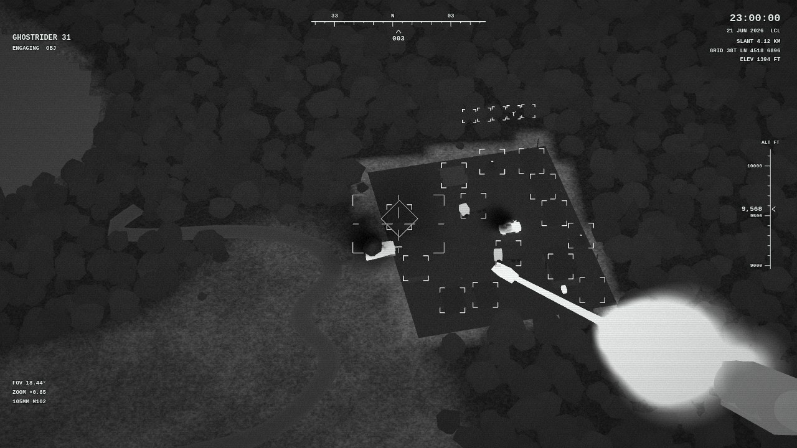
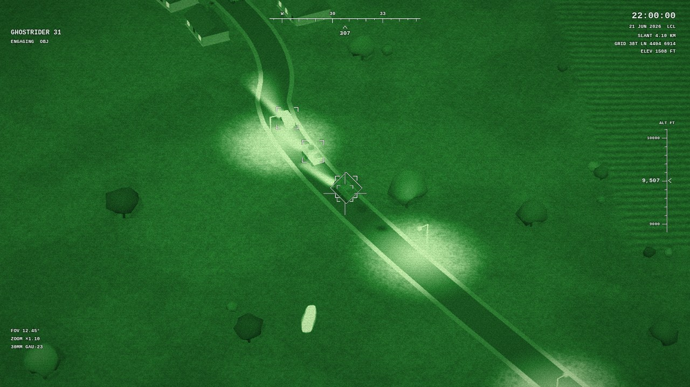
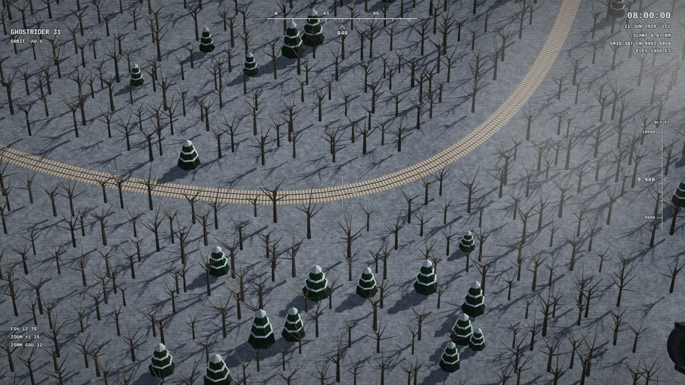

# Danger Close — web wallpaper for Wallpaper Engine

The view through an AC-130 gunship's sensor. The aircraft flies a slow left-hand orbit over a generated countryside —
hills, lakes, a river, towns, roads and a railway, fields and forests — and the picture is what its camera sees: TV,
white-hot or black-hot thermal, or night vision, under a sensor HUD with your own callsign. In silence the allies patrol
out of their outposts. When music plays the enemy comes in columns and builds a base, and the gunship fires on the beat.
Day and night follow your PC clock, the land follows the seasons.

- **Live demo** (runs in the browser): https://wladbelsky.github.io/Danger-Close/

## Install

1. Copy the `Danger Close` folder into
   `...\Steam\steamapps\common\wallpaper_engine\projects\myprojects\`,
   or in Wallpaper Engine choose **Open Wallpaper → Open from File** and pick `project.json`.
2. The fight needs music: audio recording must be on in Wallpaper Engine's settings (it is by default).
3. The vision-mode buttons (top left) and the weapon selector (bottom) need mouse input enabled in Wallpaper Engine.

## Performance

The world is built once at start under the splash screen (usually 2–4 s); after that the simulation takes a fraction of a
millisecond a frame and the picture a few hundred draw calls. To go lighter: lower the **FPS limit** in Wallpaper
Engine (30 is plenty), set **Quality** to Medium or Low, turn **Shadows** off. Wallpaper Engine pauses it under
fullscreen apps by default.

## The sensor

- **Four vision modes**: TV (a low-light daylight camera), thermal white-hot and black-hot, night vision. Thermal shows
  real heat: engines and gun barrels hot, wrecks cooling in stages, the ground warmer than the air at night, water the
  other way round, smoke cold. Click a mode on the HUD; the **Vision mode at start** property sets the default — *Auto*
  out of the box: TV by day, thermal at night.
- **The HUD**: mode, callsign, compass, altitude ladder, the PC clock, a reticle per weapon, corner brackets on what it
  tracks (allies blue, enemies white), the weapon selector with cosmetic ammunition and reloads. It keeps clear of the
  taskbar (**HUD space kept free at the bottom**) and scales with **HUD scale**.
- **The camera**: a left orbit over one area, a transit to another every few minutes in silence; in a fight it slews
  onto the enemy, each weapon with its own zoom.
- **The big guns in frame**: the barrels of the 105 mm and the railgun (while enabled) at the bottom right, fixed to the
  aircraft — they move in the frame as the sensor turns and zooms, recoil on every shot, flash, smoke and heat up.

## The fight

- **Music arms it**: after 5 s of sound the enemy arrives — always out of sight — in columns along the roads, squads and
  helicopters, and builds a base on a cleared site. The camera goes there.
- **The allies** are always out: garrisons in walled outposts, patrols, helicopters; in a fight they drive to the base
  and fight it out. Both sides shoot at each other.
- **The gunship fires on the beat**, only at what is under the reticle and only at what its weapon may hit:

| Weapon | Infantry | Car | APC | Tank | Helicopter | Beat |
|---|---|---|---|---|---|---|
| 25 mm Gatling | + | + | + | | | high |
| 30 mm cannon | + | + | + | | | mid |
| 105 mm howitzer | + | + | + | + | | low |
| 40 mm Bofors | + | + | + | | | mid |
| Hellfire | | + | + | + | | strong |
| APKWS rockets | + | + | + | | | strong |
| GBU-39 | + | + | + | + | | strong |
| AIM-9X | | | | | + | strong |
| Laser (red, lights up what it hits) | + | + | + | + | + | held on the beat |
| Railgun | + | + | + | + | + | strong, through a column |

  The first three are on by default; each is a property. Automatic switching picks one for the targets and the music;
  a click on one holds it for 30 s, or until nothing it may hit is left round where the aircraft is.
- **The music stops**: 5 s later fire ceases, the enemy pulls back out of the frame and vanishes; the base is removed
  once it is out of view. Infantry vanish in a puff of dust, vehicles lie as wrecks and sink. No civilians, no blood.

## The world

- About 2 × 2 km, made from a **seed** (0 = a new map every start): gentle hills, lakes and a river, a town and villages,
  a station on the railway, farms, roads with bridges, fields and forests.
- **Seasons** by the PC date (or fixed): spring green, autumn colours, snow and bare trees in winter.
- **Weather**: rain, snow, fog, clouds drifting under the aircraft; anti-aircraft fire rising past the lens with flares
  in reply (looks only).
- **At night**: lit windows, street lamps, headlights, searchlights on the outposts' towers, navigation lights on the
  helicopters; their light falls on the ground and stops at walls and buildings.

## Properties

Sensor & HUD (vision mode, zoom, orbit speed, transits, callsign, HUD scale and bottom space), time & weather (PC clock or
a fixed hour, season, weather, clouds), every weapon and the automatic switching, the fight (audio sensitivity, how often
it fires, enemy forces, allied reinforcements, anti-aircraft fire), the map seed, shadows and quality.

## Browser preview

`python -m http.server 8767` in this folder, then http://localhost:8767/. A ⚙ button at the bottom right opens every
property; it also has a demo beat and an audio file player to start a fight. URL parameters for testing: `?hour=22`,
`?season=winter`, `?mode=wh`, `?seed=11`, `?weapons=all`, `?demo=124` and more (see `CLAUDE.md`).

## Tests

Playwright in Docker (no local Node needed): `powershell -ExecutionPolicy Bypass -File tools/test.ps1`. They cover the
map (same seed → same map, the ground matches its mesh), units (never in water or walls), the fight (arming, the weapon
table, stand-down, the map's edge), vision modes (no shader recompiles), lights, the guns, the properties and a soak run.

Built with [three.js](https://threejs.org/) r187. Original work: no names, logos or assets of existing games.
